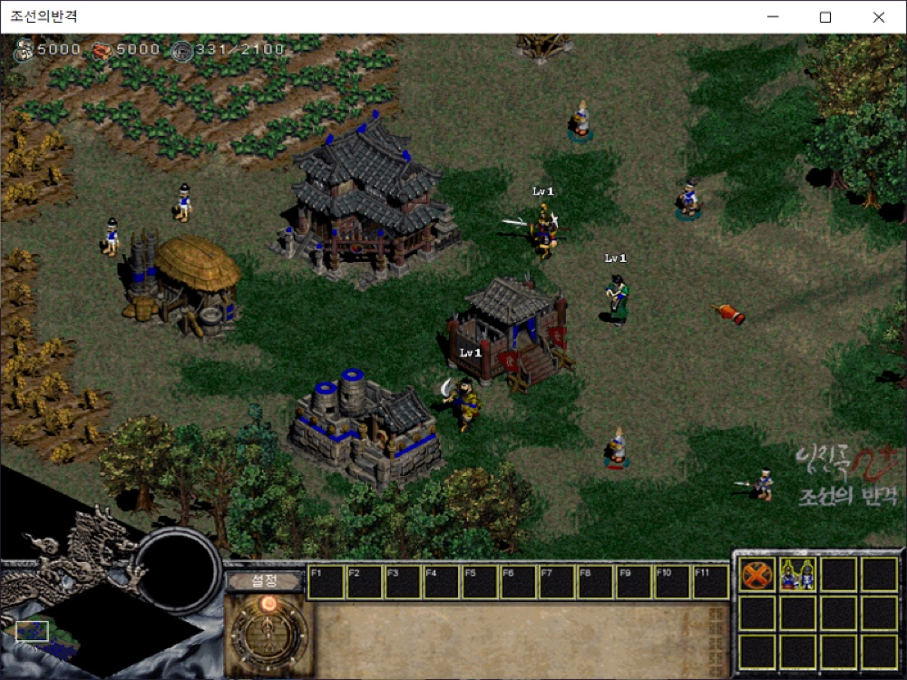

# 임진록2+ 유즈맵 패치

임진록2+ 조선의반격(HQ팀)의 실행파일을 고쳐, 일반 게임에서 맵에 배치해 둔 유닛을 불러오게 하는 바이트 패치다. 유닛을 미리 놓아 둔 맵을 그대로 플레이할 수 있다. 바꾼 바이트와 어셈블리 해석은 [docs/usemap-patch.ko.md](docs/usemap-patch.ko.md) 에 있다.

**호환 버전**: 임진록2+ 조선의반격 v1.1000 (+ HQ Net 패치), `syw2plus.exe` md5 `ec9f2843de992af91c575bab2e9b64fe`

<p>
  
</p>


## 사용 방법

패치는 문서의 표를 보고 직접 적용한다.

1. 게임 폴더의 `syw2plus.exe` 를 백업하고 md5 가 위 값과 같은지 확인한다.
2. 헥스 에디터로 [docs/usemap-patch.ko.md](docs/usemap-patch.ko.md) 표의 파일 오프셋마다 원래 바이트를 확인하고 바꾼 바이트로 덮어쓴다.
3. 고친 실행파일로 유닛을 배치해 둔 맵을 골라 일반 게임을 시작하면 맵의 유닛이 나온다.


## 구현 원리

**시작 유닛 대신 맵의 유닛을 만든다.** 게임을 시작할 때 시작 유닛을 만드는 함수가 플레이어 여덟 명을 돌며 종족에 맞는 시작 유닛을 플레이어 시작 위치에 만든다. 게임에는 이와 별도로, 맵의 유닛 배치 표(16바이트 항목 800개: 종류, x, y, 소유 플레이어)를 돌며 같은 생성 함수 `0x00443190` 을 부르는 루프가 들어 있다. 패치는 시작 유닛을 만드는 `CALL` 여섯 개를 `NOP` 으로 지우고, 시작 유닛 함수의 마지막 `ret` 을 이 루프로 가는 `JMP` 로 바꾼 뒤, 루프가 끝나는 자리에서 다시 `ret` 으로 돌아오게 했다.

```
0041F356  E9 A0 4B 0A 00        jmp  0x004C3EFB        ; 맵 유닛 배치 루프로
0041F35B  C3                    ret
...
004C3F73  E9 E3 B3 F5 FF        jmp  0x0041F35B        ; 루프가 끝나면 ret 으로
```

생성 함수는 인자를 호출한 쪽이 정리하는 cdecl 이라, `CALL` 다섯 바이트만 지워도 앞의 `push` 와 뒤의 `add esp, 0x1C` 가 짝을 이뤄 스택이 맞는다. 루프 안의 코드는 원래 게임에 들어 있던 것을 그대로 쓰고, 점프 두 개로 들어갔다 나오기만 한다.


## 파일

| 경로 | 내용 |
|---|---|
| `docs/usemap-patch.ko.md` | 대상 파일, 바꾼 바이트 표, 어셈블리 해석 |
| `docs/screenshots/` | 스크린샷 |


## 라이선스

zlib 라이선스다. 자세한 내용은 [LICENSE](LICENSE) 에 있다.
